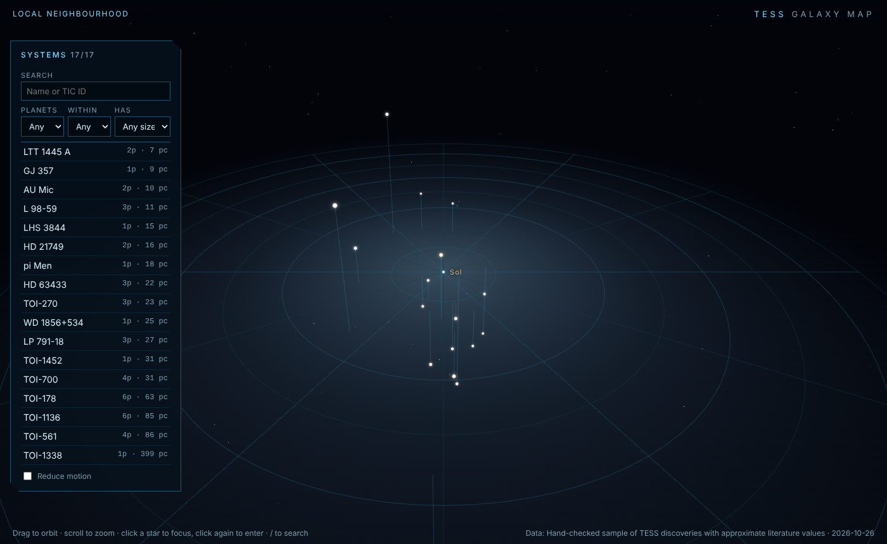
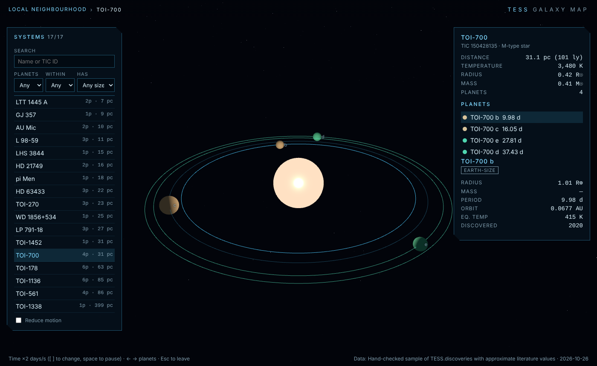

# TESS Galaxy Map

Fly through planetary systems discovered by NASA's **Transiting Exoplanet Survey Satellite (TESS)** in your browser. The interface is modelled on the galaxy map in *Mass Effect*: start zoomed out over the Sun's neighbourhood, pick a star, fly to it, then drop into the system to watch its planets orbit and read their data.





## Who it's for

Astronomy enthusiasts, students and educators who want a feel for where TESS planets are and what they're like, without reading tables. It also shows how to turn archive data into a 3D scene with nothing more than three.js.

## Features

- **Galaxy view.** Every TESS host star is placed by its real sky position and distance, then distance-compressed so close and far stars both fit. The grid lies on the galactic plane. Stars are coloured by temperature, and drop lines show their height above or below the plane.
- **Fly-to navigation.** Hover for a targeting reticle, click to fly to a star, then click again (or press Enter) to enter the system.
- **System view.** The host star and its planets on log-scaled orbits, moving at their real relative speeds. Planets are coloured by equilibrium temperature. Temperate orbits (175–320 K) are highlighted.
- **Data panels.** Distance, temperature, radius and mass for the star. Radius, mass, period, orbit, equilibrium temperature and discovery year for each planet. Values the archive doesn't provide are estimated and labelled "est.".
- **Search and filters.** Search by name or TIC ID, and filter by planet count, distance or planet size.
- **Deep links.** `#/system/toi-700` opens a system directly.
- **Keyboard and accessibility.** `/` to search, Enter to go in, Esc to go back, ← → to step through planets, `[` `]` to change time speed, Space to pause. Includes a reduced-motion toggle that follows your OS setting.

## Built with

- [three.js](https://threejs.org/) for rendering (custom glow-sprite shader, OrbitControls)
- TypeScript and [Vite](https://vitejs.dev/)
- [Vitest](https://vitest.dev/) for unit tests, ESLint with typescript-eslint for linting
- GitHub Actions for CI and GitHub Pages deploys

No backend, no API keys, no tracking.

## Getting started

Requires Node.js 20 or newer.

```bash
npm install
npm run dev        # http://localhost:5173
```

Other scripts:

| Command | What it does |
| --- | --- |
| `npm run build` | Production build to `dist/` |
| `npm run preview` | Serve the production build |
| `npm test` | Unit tests |
| `npm run lint` | ESLint |
| `npm run typecheck` | TypeScript, no emit |
| `npm run check` | All of the above, as CI runs them |
| `npm run fetch-data` | Refresh the star data from the NASA Exoplanet Archive |

## Data

The app reads `public/data/tess-systems.json`. Each row is one planet, using the column names from the archive's [Planetary Systems Composite Parameters](https://exoplanetarchive.ipac.caltech.edu/docs/pscp_about.html) (`pscomppars`) table.

**The committed file is a small, hand-checked sample** of 17 well-known TESS systems (44 planets) with approximate literature values. To pull every TESS discovery from the archive, run:

```bash
npm run fetch-data
```

This sends one query to the archive's TAP service:

```sql
select pl_name, hostname, ra, dec, sy_dist, st_teff, st_rad, st_mass,
       pl_rade, pl_bmasse, pl_orbper, pl_orbsmax, pl_eqt, disc_year, tic_id
from pscomppars
where disc_facility like '%TESS%'
```

### Scales

Real distances and orbits span too many orders of magnitude to show at once, so the map compresses them:

- Star distance from the Sun uses `30 · log2(1 + d / 8 pc)`. Direction is exact; distance order is kept.
- Orbit radius, planet size and star size are log-scaled. Orbital **periods** are real, so relative motion within a system is correct.
- Where the archive has no semi-major axis, it comes from Kepler's third law. Where it has no equilibrium temperature, the panel shows `Teff · sqrt(R* / 2a)` (zero albedo), marked "est.".

## Project layout

```
src/
  astro/     coordinate transforms, colour from temperature, orbit maths
  data/      types, archive query, parsing, filters, URL routes
  scene/     GalaxyView, SystemView, CameraDirector, picking, glow sprites
  ui/        info panel, system list, formatting
  main.ts    app wiring, input, transitions, overlay labels
scripts/     fetch-tess-data.ts
tests/       Vitest unit tests
```

## Roadmap

See [ROADMAP.md](ROADMAP.md).

## Credits

- This research has made use of the [NASA Exoplanet Archive](https://exoplanetarchive.ipac.caltech.edu/), which is operated by the California Institute of Technology under contract with NASA under the Exoplanet Exploration Program.
- TESS is a NASA Astrophysics Explorer mission led and operated by MIT.
- The interface is inspired by the galaxy map in BioWare's *Mass Effect*. This is an unaffiliated fan-made visualizer, and it uses no game assets.

## License

[MIT](LICENSE)
